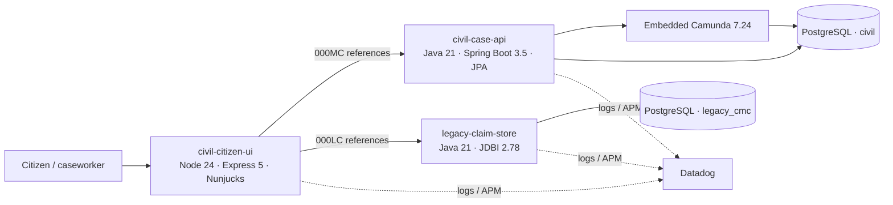

# Make a money claim — HMCTS demo

**DEMO – this is not a real government service.** Synthetic data only; no court submissions or real payments. Uses GOV.UK Design System components without government logos or Transport fonts.

## Architecture



## Local setup

Requirements: Docker + Compose. For host development: Node 24, Java 21 and Maven 3.6.3+.

```sh
make up
# citizen: http://localhost:3000
# modern:  http://localhost:8080/health
# legacy:  http://localhost:8081/health
# cockpit: http://localhost:8080/camunda (admin / admin, demo only)
make test
make reset
make down
```

Postgres is on host port 5433. Defaults are synthetic local credentials only. Override `SESSION_SECRET`, `POSTGRES_PASSWORD`, `DEMO_RESET_TOKEN` outside local use. See [CONTRACTS.md](CONTRACTS.md) for environment variables, frozen API shapes and ownership. To run the UI without Docker: `cd citizen-ui && npm ci && npm run dev`. APIs build from repository root via `mvn -s .mvn/settings.xml -f civil-case-api/pom.xml package` and `mvn -s .mvn/settings.xml -f legacy-claim-store/pom.xml -DskipTests package`. The public Central mirror avoids observed rate-limiting in the demo build environment.

## Parallel build status

Stage A supplies the runnable shared shell, database structures, build/deployment configuration and integration contracts. Stage B implements the four flows, domain rules, workflow, observability transport and seed/reset SQL. Until then, feature links return branded 404s rather than pretending to submit anything. Health endpoints and base page work; `/api` business endpoints are specified, not yet implemented.

## Render setup

Create a Blueprint from this repository's `render.yaml` using Render's official deployment workflow. It defines three Docker web services and managed Postgres, all in Frankfurt. No deployment is triggered by local builds. The API client supports Render's internal `hostport` references. Java startup converts `DATABASE_URL` into JDBC settings. Stage C must set `DD_API_KEY`, `DD_SITE`, `DD_ENV=demo`, `DD_VERSION=<git SHA>` and a working agent/collector transport before enabling traces. API keys alone do not provide APM transport. Do not create Datadog monitors or Slack routing.

Default Camunda credentials are strictly demonstration credentials, not production security. Restrict demo access if deploying beyond the intended audience. The UI session store is bounded in-memory and resets on redeploy; it is not a horizontally distributed production identity system.

## Planned demo identities and references

Fake sign-in role picker: claimant (`demo-claimant`), defendant (`demo-defendant`), caseworker (`demo-caseworker`); no password. Seed contract: 160 modern claims + 40 legacy, `000MC001` and `000LC001` awaiting response, code `DEMO2026`; these records arrive in Stage B. Planned routes: `/make-claim/eligibility`, `/respond`, `/dashboard`, `/caseworker`, `/ops`.

## Domain logic map

Paths below identify Stage B implementation targets; the skeleton does not yet contain the calculators.

| Rule | File / package target | Service |
|---|---|---|
| Court fee bands (online = paper) | `.../civil/domain/FeeCalculator.java` | civil-case-api |
| 8% simple interest, daily rate | `.../civil/domain/InterestCalculator.java` | civil-case-api |
| Response deadline, bank holidays | `.../civil/domain/DeadlineCalculator.java` | civil-case-api |
| Reference generation | `.../civil/domain/ClaimReferenceGenerator.java` | civil-case-api |
| Valid state transitions | `.../civil/domain/ClaimStateMachine.java` | civil-case-api |
| Evidence validation/storage | `.../civil/document/DocumentStore.java` | civil-case-api |
| Issue → response / expiry workflow | `.../civil/camunda/`, `resources/camunda/` | civil-case-api |
| Legacy deadlines (Date/Calendar) | `.../legacy/service/LegacyResponseDeadlineCalculator.java` | legacy-claim-store |
| Legacy claims/offers/reference SQL | `.../legacy/repository/` | legacy-claim-store |

Modern tests: JUnit 5, Testcontainers and Camunda assert. UI tests: Vitest/Supertest. Legacy deliberately has **build-only CI and no unit tests**; it must nevertheless work correctly. No deliberate bugs are included.

## Research and attribution

Public GOV.UK fee/interest guidance and MIT-licensed HMCTS repositories informed contracts and wording. Source links, current fee bands and explicit demo simplifications are in [CONTRACTS.md](CONTRACTS.md). No accounts were created and no forms submitted to government services. GOV.UK Frontend is used under its distributed licence; government logos and copyrighted font assets are not served.
